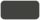
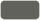

# Brand guide


Everything here is defined in [`uoProjects/Styles/app.css`](uoProjects/Styles/app.css).

## Colours

Each colour has a name. Use it with any Tailwind prefix: `bg-primary`, `text-text`, `border-border`, `hover:bg-surface-hover`.
Add `/20` (or any number) for transparency: `border-primary/20` is garnet at 20%.
In CSS or an inline style, use `var(--color-primary)`.

### Main colours

The site is **dark mode only**. Surfaces and text use the first group; garnet is the accent.

| | Name | Hex | Use it for |
| --- | --- | --- | --- |
|  | `background` | `#3a3a37` | Page background |
|  | `dark` | `#2d2d2c` | Sidebar, footer, tooltips, text on light fills |
|  | `surface` | `#42423f` | Cards, tables, dialogs, controls |
|  | `surface-hover` | `#4b4b47` | Hovered rows and controls, topic chips |
|  | `text` | `#f2f2f2` | Main text, headings |
|  | `text-secondary` | `#ccc5c0` | Descriptions, inactive navigation, footer links |
|  | `text-faint` | `#b8afa8` | Fine print, placeholders |
|  | `border` | `#62625d` | Borders, row dividers, the sidebar's right edge |
|  | `primary` | `#8f001a` | Buttons and the selected sidebar row. This is uOttawa Garnet. |
|  | `primary-hover` | `#7b0016` | Button or selected row when hovered |
|  | `focus` | `#e4b6bf` | Keyboard focus outlines, link hover, focused fields |
|  | `white` | `#ffffff` | Text and icons on `primary` |
|  | `disabled` | `#c4c4c4` | Disabled button background |
|  | `disabled-text` | `#757575` | Disabled button text |

Garnet is too dark to read as text on the dark background, so links and focus use `focus` instead.


### Status colours

Only use these to show status.

| | Name | Hex | Means |
| --- | --- | --- | --- |
|  | `success` | `#0ca30c` | Good: valid, accepting, all clear |
|  | `success-text` | `#006300` | |
|  | `error` | `#d03b3b` | Needs attention: errors and invalid fields |
|  | `error-text` | `#b42318` | |
|  | `feedback-error` | `#ffaaaa` | Error text and messages on the dark background |
|  | `muted` | `#80746c` | Neutral: paused, nothing pending |

### Matching colours

Only use these to show how far a student or inquiry has got.

| | Name | Hex | Means |
| --- | --- | --- | --- |
|  | `stage-1` | `#4cc9f0` | Sent (no outcome yet) |
|  | `stage-4` | `#f72585` | Matched |
|  | `muted` | `#80746c` | Closed, no match |
|  | `chart-neutral` | `#b9b4af` | No inquiries, stopped, archived |

### Chart colours

One hue, light to dark: darker means more. Charts about matching use the matching colours instead.

| | Name | Hex |
| --- | --- | --- |
|  | `mono-1` | `#dde3ef` |
|  | `mono-2` | `#b3bfd6` |
|  | `mono-3` | `#8496b9` |
|  | `mono-4` | `#56689a` |
|  | `mono-5` | `#2f3d6b` |

## Topics

All ten topic tags are grey, told apart by a [Lucide](https://lucide.dev) icon. Use `<TopicChip Name="…" />`.

| Topic | Icon |
| --- | --- |
| AI/ML | `brain-circuit` |
| Software Engineering | `code-xml` |
| Web & Mobile | `globe` |
| Security & Privacy | `shield-check` |
| Data & Databases | `database` |
| Systems & Networks | `server` |
| HCI & Design | `palette` |
| Games & Graphics | `gamepad-2` |
| Theory & Algorithms | `sigma` |
| Other | `shapes` |

## Fonts

**Work Sans** for everything, loaded from Google Fonts in [`uoProjects/wwwroot/index.html`](uoProjects/wwwroot/index.html).

| Text | Size | Weight | Colour |
| --- | --- | --- | --- |
| Page title | 36px (48px on wider screens) | Bold | `text` |
| Body text | 16px | Regular | `text` |
| Label (`label` class) | 12px, uppercase | Bold | `text` |
| Descriptions | 14–16px | Regular | `text-secondary` |
| Fine print | 12px | Regular | `text-faint` |

## Logo

Three versions of the uoProjects logo live in [`public/`](public/) (copied to `wwwroot/brand/` at build). All are the garnet mark with no outline:

| File | Use |
| --- | --- |
| `uoProjectsLogo.svg` | Light lettering, for the dark background: the sidebar and the sign-in page |
| `uoProjectsLogo-on-light.svg` | Dark lettering, for light backgrounds |
| `uoProjectsLogo-minimal.svg` | The mark alone: the narrow sidebar on phones and the favicon |

## MudBlazor

[MudBlazor](https://mudblazor.com) is set up (`AddMudServices`, the providers in `MainLayout`, and the dark theme in [`uoProjects/Theming/AppTheme.cs`](uoProjects/Theming/AppTheme.cs), which uses the colours above). **Use a MudBlazor component whenever it can do the job**, and give it our classes so it looks the same.

| Component | Built on |
| --- | --- |
| Buttons (`btn`) | `MudButton` |
| Filter chips, topic chips (`chip`, `topic-chip`) | `MudChip` |
| Switch | `MudSwitch` |
| Tabs (`TabStrip`) | `MudTabs` |
| Search box | `MudTextField` |
| Menus in toolbars and table cells (`SelectBox`, `CellSelect`) | `MudSelect` |
| Panels | `MudPaper` |
| Stat cards, footer links | `MudLink` |
| Form-level errors (`alert`) | `MudAlert` |
| Every icon (`Icon`) | `MudIcon`, drawing the Lucide icons |

Not built on MudBlazor, because it has nothing that matches: the data table (our columns, sorting and export), the charts, the share bar and its hover label, the ring meter, and the underline text fields in forms.

MudBlazor's stylesheet is bundled into `app.css` below Tailwind (`@layer mud`) by `Styles/prepare-mud.mjs`, which drops its helper classes (`px-2`, `d-flex` and so on) because they clash with Tailwind's. Don't link `MudBlazor.min.css` separately: it would override Tailwind and change how everything looks.

## Layout

Signed-in pages have a **left sidebar** instead of a top bar: 232px wide on `dark`, with a thin `border` on its right edge, sticky at full height.

- Logo at the top, then one row per section (icon + label, 44px tall). Account actions (user name, Sign out) sit at the bottom.
- The selected row is solid `primary` with white text, running edge to edge across the sidebar. There are no underlines or divider lines. Other rows use `text-secondary` and `surface-hover` on hover.
- At 700px wide and below the sidebar becomes a 64px icon rail. Labels stay available to screen readers and as tooltips.
- Use the `side-link` class for a sidebar row; set `aria-current="page"` on the active one.
- In-page tabs (`TabStrip`) are pills: `primary` when selected, `text-secondary` otherwise.

## Buttons

| Class | Looks like | Use it for |
| --- | --- | --- |
| `btn` | Red pill, white text | The main action |
| `btn btn-secondary` | Outlined pill, light text | Cancel, Back |
| `btn-sm` (add to either) | Smaller | Tight spaces |

```html
<button type="button" class="btn">Save</button>
<button type="button" class="btn btn-secondary">Cancel</button>
<button type="button" class="btn btn-sm">Sign out</button>
```

Add `disabled` to grey a button out. For an arrow that slides on hover, add `group` and put `<Arrow />` inside:

```razor
<button type="submit" class="group btn w-full">Sign in <Arrow /></button>
```

## Forms

| Class | What it is |
| --- | --- |
| `label` | Small uppercase label above a field |
| `field` | Text input with an underline |
| `field-error` | Error under a field |
| `alert` | Error box for the whole form |

## Layout classes

| Class | What it is |
| --- | --- |
| `card` | `surface` panel with a `border` on the page background |
| `data-table` | List table, every column left-aligned |
| `chip` | Pill filter button; goes light (`text` fill, dark text) when pressed |
| `control` | Pill search box or menu, the same height as `chip` and `btn-sm` |
| `cell-select` | Small pill menu inside a table cell |
