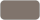
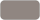

# Brand guide


Everything here is defined in [`web/Styles/app.css`](web/Styles/app.css).

## Colours

Each colour has a name. Use it with any Tailwind prefix: `bg-primary`, `text-dark`, `border-divider`, `hover:bg-hover`.
Add `/20` (or any number) for transparency: `border-dark/20` is the dark colour at 20%.
In CSS or an inline style, use `var(--color-primary)`.

### Main colours

| | Name | Hex | Use it for |
| --- | --- | --- | --- |
|  | `primary` | `#8f001a` | Buttons, focus outlines, active tabs, the red banner. This is uOttawa Garnet. |
|  | `primary-hover` | `#7b0016` | Button when hovered |
|  | `dark` | `#2d2d2c` | Main text, the logo, field underlines |
|  | `muted` | `#80746c` | Secondary text, placeholders, footer links |
|  | `faint` | `#908681` | Fine print |
|  | `light` | `#f2f2f2` | Page background, badges |
|  | `white` | `#ffffff` | Cards, dialogs, the header bar, text on `primary` |
|  | `hover` | `#dfdfdf` | Background of fields and rows when hovered |
|  | `divider` | `#c8c9c7` | Thin divider lines |
|  | `disabled` | `#c4c4c4` | Disabled button background |
|  | `disabled-text` | `#757575` | Disabled button text |


### Status colours

Only use these to show status.

| | Name | Hex | Means |
| --- | --- | --- | --- |
|  | `success` | `#0ca30c` | Good: valid, accepting, all clear |
|  | `success-text` | `#006300` | |
|  | `error` | `#d03b3b` | Needs attention: errors, invalid fields, pending work |
|  | `error-text` | `#b42318` | |
|  | `muted` | `#80746c` | Neutral: paused, nothing pending |

### Matching colours

Only use these to show how far a student or inquiry has got.

| | Name | Hex | Means |
| --- | --- | --- | --- |
|  | `stage-1` | `#4cc9f0` | Sent (inquiry: Pending) |
|  | `stage-2` | `#4361ee` | Viewed |
|  | `stage-3` | `#7b2cbf` | Talking (inquiry: Responded) |
|  | `stage-4` | `#f72585` | Matched (inquiry: Closed) |
|  | `chart-neutral` | `#b9b4af` | No inquiries, stopped, archived |

### Chart colours

One hue, light to dark: darker means more. Charts about matching use the matching colours instead.

| | Name | Hex |
| --- | --- | --- |
|  | `mono-1` | `#dde3ef` |
|  | `mono-2` | `#b3bfd6` |
|  | `mono-3` | `#8496b9` |
|  | `mono-4` | `#56689a` |
|  | `mono-5` | `#2f3d6b` |

## Topics

All ten topic tags are grey, told apart by a [Lucide](https://lucide.dev) icon. Use `<TopicChip Name="…" />`.

| Topic | Icon |
| --- | --- |
| AI/ML | `brain-circuit` |
| Software Engineering | `code-xml` |
| Web & Mobile | `globe` |
| Security & Privacy | `shield-check` |
| Data & Databases | `database` |
| Systems & Networks | `server` |
| HCI & Design | `palette` |
| Games & Graphics | `gamepad-2` |
| Theory & Algorithms | `sigma` |
| Other | `shapes` |

## Fonts

**Work Sans** for everything, loaded from Google Fonts in [`web/wwwroot/index.html`](web/wwwroot/index.html).

| Text | Size | Weight | Colour |
| --- | --- | --- | --- |
| Page title | 36px (48px on wider screens) | Bold | `dark` |
| Body text | 16px | Regular | `dark` |
| Label (`label` class) | 12px, uppercase | Bold | `dark` |
| Fine print | 12px | Regular | `faint` |

## Logo

Logo files live in `frontend/public/`.

## Buttons

| Class | Looks like | Use it for |
| --- | --- | --- |
| `btn` | Red pill, white text | The main action |
| `btn btn-secondary` | Outlined pill, dark text | Cancel, Back |
| `btn-sm` (add to either) | Smaller | Tight spaces |

```html
<button type="button" class="btn">Save</button>
<button type="button" class="btn btn-secondary">Cancel</button>
<button type="button" class="btn btn-sm">Sign out</button>
```

Add `disabled` to grey a button out. For an arrow that slides on hover, add `group` and put `<Arrow />` inside:

```razor
<button type="submit" class="group btn w-full">Sign in <Arrow /></button>
```

## Forms

| Class | What it is |
| --- | --- |
| `label` | Small uppercase label above a field |
| `field` | Text input with an underline |
| `field-error` | Error under a field |
| `alert` | Error box for the whole form |

## Layout

| Class | What it is |
| --- | --- |
| `card` | White panel on the light page background |
| `data-table` | List table, every column left-aligned |
| `chip` | Pill filter button; goes dark when pressed |
| `control` | Pill search box or menu, the same height as `chip` and `btn-sm` |
| `cell-select` | Small pill menu inside a table cell |
